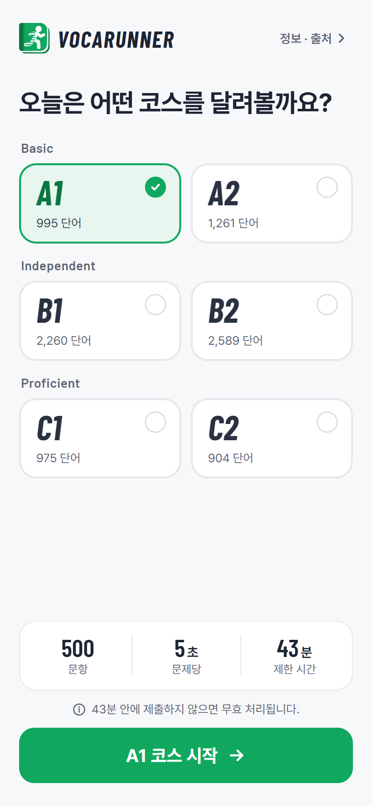
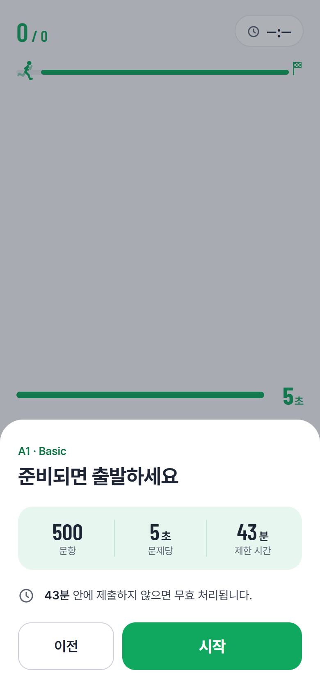
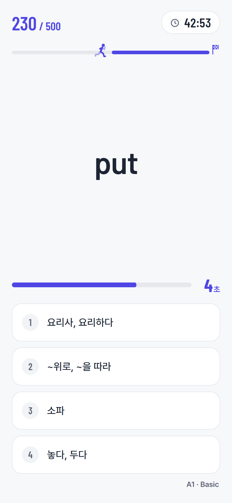
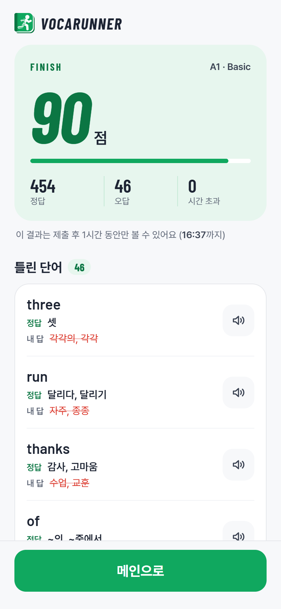
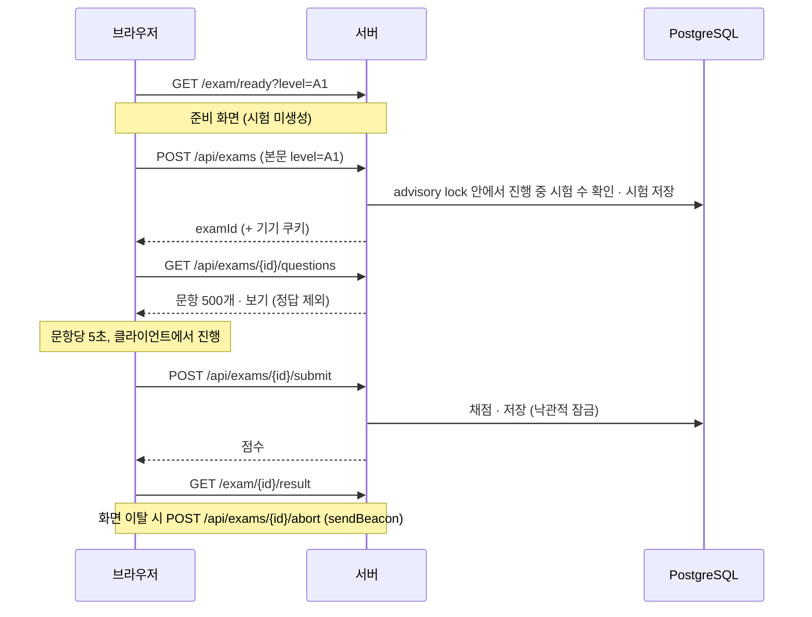
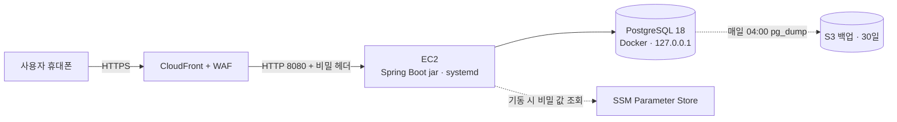
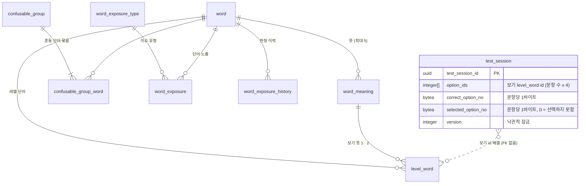

# VocaRunner

**내 영어 단어, 몇 레벨일까?** A1부터 C2까지, 단어마다 5초 안에 뜻을 고르는 영어 어휘 레벨 테스트입니다.

🔗 **https://vocarunner.com** (휴대폰 화면 기준)

| 메인 | 준비 | 시험 | 결과 |
|---|---|---|---|
|  |  |  |  |

## 개요

- **1인 프로젝트 — 기획부터 운영까지**
  - 서비스 기획, 단어 데이터 기준 수립 및 판단, 개발, AWS 배포, 운영
- **기간**: 2026.10 ~ 현재 운영 중
  - 10/01 착수 → 10/07 첫 커밋 → 10/30 서비스 오픈 → 11/03 ~ 11/06 아키텍처 전환 · 리팩토링 → 11/07 재배포
- **데이터**
  - 영어 단어 약 8,600개, 혼동 단어 묶음 7,300개
  - 한국어 뜻: 수립한 기준에 따라 AI가 작성하고, 판단이 어려운 항목은 직접 결정 · 작성
- **품질 검증**
  - 자동 테스트 234건 (`./gradlew check`, 실제 PostgreSQL 기반 DB 테스트 포함) 및 코드 스타일 검사
  - 브라우저 테스트 300회 이상, 리팩토링 후 회귀 테스트 100회
    - AI가 휴대폰 크기 화면을 직접 조작해 시험 전 과정을 수행
  - 발견 문제 84건(버그 11 · 사용성/설계 55 · 데이터 18) 기록 및 처리 (일부는 검토 후 보류)
- **운영**
  - 일일 DB 백업 (S3)
  - 복원 시험으로 백업 유효성 확인 (10/31)
  - 월 비용 상한 초과 시 자동 정지

## 기술 스택

| 구분 | 기술 |
|---|---|
| Backend | Java 25, Spring Boot 4.1, Spring Data JPA, Bean Validation |
| Frontend | Thymeleaf, JavaScript, CSS |
| Database | PostgreSQL 18 |
| Test | JUnit 6, MockMvc, Testcontainers, Checkstyle |
| Browser Test | Playwright MCP (AI가 화면 조작) |
| Infra | AWS EC2 (t4g.small, ARM), CloudFront + WAF, Route 53, ACM, SSM Parameter Store, S3, Budgets |

## 시험 흐름

1. **메인** `/`
   - 레벨 선택 (레벨별 출제 단어 904 ~ 2,589개)
2. **준비** `/exam/ready`
   - 문항 수 · 제한 시간 안내
   - 이 단계에서는 시험을 생성하지 않음
3. **시작**
   - [시작] 시점에 시험 생성 및 시간 측정 개시
   - 500문항, 문항당 5초
   - 제한 시간 43분: 500 × 5초 + 여유 1분 = 42분 40초, 분 단위 올림
4. **응시**
   - 문항 500개와 보기를 한 번에 수신해 화면에서 진행
   - 정답은 클라이언트로 전달하지 않음
5. **제출**
   - 서버에서 채점
   - 응시 중 화면을 이탈하면 시험 중단
6. **결과** `/exam/{id}/result`
   - 점수, 틀린 단어(정답 · 선택한 답 · 발음 듣기)
   - 1시간 보관 후 삭제



| API | 역할 |
|---|---|
| `POST /api/exams` (본문 `level`) | 시험 시작 — 동시 진행 상한: 기기당 1 · IP당 50 · 전체 20,000 |
| `GET /api/exams/{id}/questions` | 문항 · 보기 전달 — 반복 호출 시 동일 문항 반환 |
| `POST /api/exams/{id}/submit` | 제출 · 채점 |
| `GET /api/exams/{id}/result` | 결과 조회 — 제출 응답 유실 시 클라이언트가 결과 존재 여부 확인 |
| `POST /api/exams/{id}/abort` | 시험 중단 — 화면 이탈 시 |

- **보기 생성 규칙**
  - 오답 보기는 정답과 같은 레벨의 단어 뜻에서 선정
  - 한국어 뜻이 하나라도 겹치는 보기는 제외
  - 뜻이 같거나 비슷한 단어(예: sir ↔ teacher)는 한 문항에 함께 출제하지 않음
  - 뜻이 외래어뿐인 단어(버스 · 피자 등)와 부적절한 단어는 정답 · 오답 모두에서 제외
- **기타**
  - 회원 가입 · 로그인 없이 바로 응시
  - 발음은 브라우저 내장 음성 합성(TTS) 사용

## 주요 설계 결정

| 결정 | 검토한 대안과 제외 이유 | 감수한 비용 | 재검토 조건 |
|---|---|---|---|
| CloudFront → EC2 단일 서버 (로드밸런서 · NAT · Nginx 미사용) | 로드밸런서(월 $16 이상) · NAT(월 약 $45) 도입 시 월 상한(세전 $30) 초과. HTTPS · 도메인 · WAF는 CloudFront로 충분 | 재시작 · 장애 시 서비스 중단 | 동시 사용자 증가 시 로드밸런서 + 서버 2대 구성 |
| 시험 1회 = DB 1행 (보기 id 배열, 답은 문항당 1바이트) | 문항별 행 저장: 시험 1회당 500행 기록 / 메모리 저장: 재시작 시 유실 / Redis: 서버 · 비용 증가 | 단어별 정답률 등 통계 산출이 어려움 | 통계 기능 도입 시 요약 테이블 별도 구성 |
| 문항 일괄 전달, 채점은 서버 | 문항별 서버 왕복: 요청 500회, 5초 제한 안에서 응답 지연이 풀이 시간을 잠식 | 문항당 5초 제한은 클라이언트에서만 적용 | 순위 · 보상 도입 시 문항별 서버 검증 |
| 로그인 미도입, 결과 1시간 보관 | 회원 가입: 개인정보 수집 · 보호 부담, 진입 장벽 증가 | 응시 기록 미보존 | 로그인 · 시험 기록 기능 도입 시 |
| 사용자 식별 = 기기 쿠키 + IP 상한 | IP 단위 식별: 학교 · 통신사(CGNAT)처럼 공인 IP를 공유하는 사용자 차단 | 쿠키 삭제 시 새 기기로 인식 (IP당 50개 상한으로만 제한) | 남용 징후 발생 시 |
| 동시 시작 제어 = PostgreSQL advisory lock | Redis 분산 락: 단일 서버 · 단일 DB 구성에서 불필요, 인프라 · 비용 증가 | 시험 시작의 직렬 처리 (문항 생성은 잠금 밖에서 수행) | 시작 요청 집중으로 잠금 대기가 길어질 때 |
| 단어 출제 목록을 기동 시 메모리에 적재 | 출제마다 DB 조회: 500문항 · 보기 2,000개를 매번 조회 | 단어 변경 시 재적재 필요 | 관리자 단어 수정 기능 도입 시 |
| 비밀 값 = SSM Parameter Store | Secrets Manager: 비밀당 월 $0.40, 핵심 기능인 자동 교체를 이 구성(EC2 내 Docker DB)에서 활용 불가 | 값 변경 시 애플리케이션 재시작 필요 | DB를 RDS로 이전할 때 |
| 배포 = jar + systemd | 컨테이너(Docker · ECS): 단일 서버 · 단일 앱 구성에 이미지 레지스트리와 빌드 단계 추가 | 서버 JDK 버전 직접 관리 | 서버 증설 시 |
| 헥사고날(포트 · 어댑터), 기능별 패키지 | 계층형(controller · service · repository): 업무 규칙과 JPA 엔티티 · 프레임워크 결합 | 파일 수와 변환 코드 증가 | — |
| 테스트 DB = 실제 PostgreSQL (Testcontainers) | H2 인메모리 DB: advisory lock · 배열 칼럼 등 PostgreSQL 기능 미지원 또는 동작 차이 | Docker 필요, 실행 시간 증가 | — |

## 문제 해결 사례

- 사례별 배경 · 원인 · 해결 · 다른 방법과 비교 · 결과와 기타 사례 전체: [docs/troubleshooting.md](docs/troubleshooting.md)

### 1. 동일 시험의 동시 제출 처리

- **문제**: 같은 시험의 제출 요청 두 건이 동시에 도착하면 늦은 요청이 500 응답
- **발견**
  - 브라우저 테스트에서 같은 기기로 제출 요청 두 건을 의도적으로 동시 전송
  - 3단계 문제는 "동시 제출이 실제로 언제 발생하는가"를 설명하기 위해 코드를 검토하던 중 발견
- **해결** (3단계)
  1. 낙관적 잠금(`@Version`) 충돌을 "이미 종료된 시험"과 동일한 400으로 응답, 채점은 1회만 수행
  2. 롤백된 제출도 로그가 남던 문제 → 제출 로그를 커밋 이후에 기록
  3. 저장 후 응답만 유실된 경우(Wi-Fi ↔ LTE 전환 등) 재제출이 실패로 끝나 결과를 볼 수 없던 문제
     - 제출이 거절되면 결과 API로 결과 존재 여부를 확인해 결과 화면으로 이동
- **검증**
  - Testcontainers 기반 동시 제출 테스트
  - 브라우저 테스트(Playwright MCP)에서 제출 직후 연결을 끊어 재현

### 2. 동시 시작 요청의 상한 우회 차단

- **문제**: 시작 요청 8건을 동시에 보내면 상한(당시 IP당 3개)을 무시하고 8건 모두 생성
- **발견**: 브라우저 테스트에서 동시 요청으로 상한을 우회할 수 있는지 의도적으로 검증
- **원인**
  - "진행 중 개수 확인 → 저장" 사이의 경쟁 조건
  - 아직 존재하지 않는 행에 대한 조건이므로 행 잠금으로는 차단 불가
- **해결**: 확인과 저장을 `pg_advisory_xact_lock`으로 묶어 시작 요청을 직렬 처리
  - 시간이 오래 걸리는 문항 생성(500문항)은 잠금 밖에서 수행하고, 잠금 안에서는 재확인과 저장만 수행
  - 상한 초과가 확실한 요청은 잠금 전에 걸러 문항 생성 자체를 생략
  - 트랜잭션 범위 잠금이므로 커밋 · 롤백 시 자동 해제
- **결과**: 동시 요청에도 상한 유지 (전체 20,000 · IP당 50 · 기기당 1)

### 3. 흐름 재설계를 통한 경합 결함 제거

- **문제**: 시험 시작 직후 새로고침 시 드물게 500 화면이 표시되고, 시험이 진행 중 상태로 남기도 함
- **원인 분석**
  - 화면 조작으로는 55회 추가 시도에도 재현되지 않음 → 리팩토링 전에 구축한 안전망 테스트로 재현
  - 새로고침 시의 중단 처리(조회 → 삭제)와 같은 시험의 다른 요청(이탈 시 중단 요청, 문항 전달 기록)이 겹쳐 낙관적 잠금 충돌 발생
- **해결**: 예외 처리를 추가하는 대신, 진행 중이던 기획 "시험 시간 측정을 첫 문항부터 시작"에 맞춰 흐름을 재설계
  - 준비 화면을 시험 생성 앞 단계로 옮기고, [시작] 시점에 시험 생성
  - 시험 화면 주소와 새로고침 중단 경로가 사라져 **경합이 발생할 경로 자체를 제거**
- **검증**
  - 서비스 계층의 경합 동작은 재현 테스트로 고정
  - 리팩토링 후 회귀 테스트 100회

### 4. 공용 IP(CGNAT) 환경의 시작 차단 해소

- **발견**
  - 브라우저 테스트 중 제한 로직이 연결 IP 기준으로 사용자를 구분하는 것을 확인
  - 실제 환경(통신사망 · 학교 Wi-Fi · 프록시 후단)에서의 동작을 검토해 문제 도출
  - 로컬에서는 같은 기기가 IPv4 · IPv6로 각각 집계되는 현상도 확인
- **원인**
  - IP당 진행 중 3개 제한
  - 통신사망(CGNAT) · 학교 Wi-Fi는 다수가 공인 IP 하나를 공유 → 교실에서 동시에 시작하면 4번째부터 거절
- **해결**: 사용자 식별 기준을 기기 쿠키로 전환
  - 기기당 1개 (같은 기기에서 새로 시작하면 이전 시험 종료)
  - IP당 50개 상한은 쿠키를 지워 가며 생성하는 남용을 막는 용도로만 유지
- **추가 조치** (배포 설계 단계에서 사전 식별)
  - CloudFront 후단에서는 연결 IP가 모두 CloudFront 주소 → 실제 IP는 `CloudFront-Viewer-Address` 헤더에서 추출
  - EC2 8080 포트를 CloudFront에서만 접근 가능하도록 제한해 헤더 위조 차단

### 5. 혼동 단어 쌍 탐지 — 임베딩 검사와 단어 테스트의 병행

- **문제**: 뜻이 같거나 가까운 단어가 한 문항의 보기로 함께 출제되면 정답이 두 개가 됨 (예: sir "선생님" ↔ teacher "선생님")
- **규모**: 단어 약 8,600개, 뜻 문구 13,652개 → 수작업 전수 비교 불가
- **방법**
  1. 뜻 문구를 임베딩 모델(bge-m3)로 벡터화하고, 같은 레벨 내 근접 이웃과 문자열 규칙(어미 · 괄호 차이)으로 후보 6,286쌍 추출
  2. AI가 후보 쌍 판정
  3. 묶음 기준은 직접 결정하고, 유의어 쌍은 AI 판정 결과를 그대로 반영
  4. 단어 테스트로 누락 확인 — 회차마다 출제된 문항 전체 검토
- **검증**
  - 초기 모델(ko-sroberta)은 한 토큰짜리 단어(술집 · 발행인 · 온실 등)를 동일한 벡터로 산출해 무관한 쌍이 최고 점수를 받음
    - 결과를 사용할 수 없어 bge-m3로 교체 (bge-m3에서는 해당 문제 없음)
    - ko-sroberta는 접두어를 붙이면 구분된다는 조건까지 확인했으나 근본 원인은 미확정
  - 기존에 알려진 혼동 단어 쌍 21개로 측정한 결과, 자동 검사는 15개를 탐지하고 6개를 누락 (한 글자 뜻 "큰", 유사도가 낮게 산출된 "깡충 뛰기" 등)
  - 누락된 6개는 단어 테스트에서 확인해 묶음에 추가 → **두 검사를 병행하는 이유**
- **결과**
  - 혼동 단어 묶음 7,300개
  - 애플리케이션에서도 같은 뜻 보기를 한 번 더 차단 (최종 방어선)

### 기타 사례

- WAF 기본 규칙의 본문 8KB 제한이 500문항 제출(약 20KB)을 차단한다는 점을 배포 전 계산으로 확인
  - 해당 규칙만 감시(Count) 모드로 전환
- 결과 화면에서 뒤로 가면 종료된 시험이 다시 표시되는 문제
  - 원인이 bfcache가 아닌 HTTP 캐시임을 재현으로 확인, `Cache-Control: no-store` 적용

## 아키텍처



- **CloudFront → EC2 직접 연결**
  - HTTPS · 도메인 · WAF는 CloudFront에서 처리
  - EC2 8080 포트는 CloudFront에서만 접근 가능
  - CloudFront가 추가하는 비밀 헤더(`X-Origin-Verify`)가 없는 요청은 애플리케이션에서 403 응답
    - 응답 시간 차이로 값을 추정하지 못하도록 `MessageDigest.isEqual`로 비교
    - 값 교체 중에는 이전 값 · 새 값을 함께 허용해 무중단 교체
- **비밀 값 관리**
  - DB 계정 · 비밀 헤더 값은 기동 시 Parameter Store에서 조회
  - EC2 IAM 역할로 조회하므로 액세스 키 불필요
  - 조회 실패 시 애플리케이션이 기동하지 않음 (개발용 계정으로 기동되는 사고 방지)
- **응답 크기**
  - 애플리케이션 gzip 압축으로 결과 HTML 863KB → 35KB, 문제 API 190KB → 37KB (997문항 시험 기준)
- **캐시**
  - CloudFront 캐시는 사용하지 않음
  - 정적 파일은 파일명에 내용 해시를 붙여 브라우저에서 1년 캐시
  - 시험 화면 · 시험 API는 캐시 저장 금지
- **비용**
  - 평소 세전 월 약 $20.7 (서버 무료 체험이 끝나는 2027년부터)
  - 세전 $30 초과 시 예산 자동 조치로 EC2 정지 및 알림
- **운영**
  - 매일 DB 백업 (S3, 30일 보관)
  - 임시 DB에 복원해 행 수를 비교하는 복원 시험으로 백업 유효성 확인 (10/31)
- **배포**
  - 로컬에서 jar 빌드 → 서버 전송 → systemd 재시작

### 패키지 구조

```
org.ruscayn.vocarunner
├── exam                      시험: 시작 · 문항 전달 · 제출 · 중단 · 결과 · 정리
│   ├── domain                Exam(문항 목록 · 선택한 보기 · 시험 시간 · 채점 결과 · 응시자), 시험 수용량, 문항 · 보기 생성
│   ├── application
│   │   ├── port/in · out     유스케이스 · 조회 · 저장 포트
│   │   └── service           시작 · 응시 · 정리 · 조회
│   └── adapter
│       ├── in/web            컨트롤러, 기기 쿠키 · 사용자 IP
│       ├── in/scheduler      종료된 시험 정리
│       └── out/persistence   JPA 엔티티 · 저장 어댑터
├── word                      단어 출제 목록: 단어 · 뜻 · 레벨 · 혼동 단어 묶음 · 노출 규칙
│   ├── domain                단어 출제 목록, 레벨, 혼동 단어 묶음, 단어 노출 규칙
│   ├── application           출제 목록 적재 · 조회
│   └── adapter               in/startup(기동 시 적재) · out/persistence(조회) · out/memory(목록 보관)
├── common                    공통 예외 · 오류 응답 · 비밀 헤더 · 보안 헤더 필터
└── config                    설정 · 빈 구성
```

- 의존 방향: 바깥(adapter) → 안(application → domain), 기능 간에는 exam → word 단방향
- 도메인 객체는 Spring · JPA에 의존하지 않으며, JPA 엔티티는 저장 어댑터 내부에만 위치

### 코드 품질

- **규칙의 빌드 강제** (Checkstyle)
  - 우테코 자바 스타일 적용
  - 메서드 10줄 이하, main 파일 120줄 이하
  - 중첩 블록 금지, else는 한 번까지
  - 위반이 하나라도 있으면 빌드 실패
- **용어 사전**
  - 업무 용어와 코드 이름을 [`docs/glossary.md`](docs/glossary.md)로 일치
- **리팩토링 절차**
  - 외부 계약(주소 · JSON) · DB 상태를 고정하는 안전망 테스트를 먼저 구축
  - 의도적으로 결함을 넣어 테스트가 이를 검출하는지 확인한 뒤 구조 변경
  - 전환 전후 비교: [`arch-before...arch-after`](https://github.com/ruscayn/voca-runner/compare/arch-before...arch-after)

## 데이터 모델



- **단어**
  - `word` → `word_meaning`(단어당 뜻 최대 5개) → `level_word`(레벨 단어: 단어의 레벨별 1행)
  - 보기 표시용 뜻은 최대 2개(칼럼 2개)로 고정
- **단어 노출** `word_exposure`
  - 노출 처리(단어 제외 · 뜻 제외 · 레벨 제외 · 유지)별 필수 칼럼을 CHECK 제약으로 강제
  - `UNIQUE NULLS NOT DISTINCT`로 대상당 판정 1건 보장
- **시험** `test_session`
  - 시험 1회 = 1행
  - 진행 중 시험만 집계하는 부분 인덱스(기기 · IP별), 동시 제출 방지용 `version`
- **스키마**: [`src/test/resources/db/schema.sql`](src/test/resources/db/schema.sql)
  - 운영 스키마의 복사본, DB 테스트가 이 파일로 테이블 생성

## 테스트

- **자동 테스트** (JUnit 6, 234건)
  - 도메인: 문항 생성 · 채점 · 시험 시간 · 수용량 규칙
  - 웹: MockMvc로 화면 · API 응답과 오류 처리 검증 (서비스는 모킹)
  - DB: Testcontainers로 임시 PostgreSQL 18을 띄워 37건 검증
    - 매핑 · 쿼리 조건 · 잠금 · 동시성 위주
    - 프레임워크가 보장하는 단순 저장 · 조회는 대상에서 제외
  - 설정: 비밀 헤더 필터, 사용자 IP 추출, Parameter Store 설정
- **브라우저 테스트**
  - AI(Claude Code)가 Playwright MCP로 휴대폰 크기(390×844) 화면을 직접 조작해 시험 전 과정을 수행하며 화면 · 요청 · DB 상태 확인
  - 300회 이상, 리팩토링 후 회귀 테스트 100회
  - 회차마다 출제된 문항 전체를 검토해 혼동되는 보기 · 뜻 오류 탐지 (단어 테스트)
  - 테스트 스크립트로 남기지 않아 저장소에는 포함되지 않음
- **문제 기록 번호**
  - 커밋 메시지 · 코드 주석의 `(U55)` · `(B3)` 같은 번호는 브라우저 테스트 · 코드 검토 중 발견한 문제의 기록 번호 (B 버그 · U 사용성/설계 · D 데이터)
  - 기록 자체는 비공개
- **실행**
  - `./gradlew check` (테스트 + 코드 스타일 검사)
  - Docker만 필요 — DB 테스트 · 앱 기동 테스트는 임시 PostgreSQL을 사용하므로 로컬 DB · `secret.yml` 불필요
  - `dev` · `main` · `release/**` 대상 PR과 push마다 GitHub Actions에서 같은 검사를 자동 실행

## AI 활용

- **개발 방식**: AI를 팀원으로 두고 협업
- **역할 분담**
  - 중요한 설계 · 기획 판단과 도입 결정은 직접 수행
  - 기술 제안과 선택지는 주로 AI가 제시하고, 일부는 직접 먼저 제안
  - 결과는 테스트 · 브라우저 QA · 교차 리뷰로 검증
- **도구**
  - Claude Code: 구현 · 브라우저 테스트 · 데이터 검사
  - claude.ai: 설계 검토 · 교차 검증 · 문서 작성
  - Playwright MCP: 브라우저 조작
- **운영 방식**
  - 작업 주체와 검증 주체를 서로 다른 AI로 분리해 상호 검토하고, 결정 · 정정 내역을 기록으로 관리
  - 용어 사전 → 코드 이름, 코드 규칙 → Checkstyle처럼 판단 결과를 문서와 빌드로 고정
- **AI 판단을 바로잡은 사례**
  - AI 제안: 단어 출제 목록 적재 서비스가 메모리 보관용 객체를 생성해 반환
    - 판단: 보관 방식은 인프라의 책임 → 서비스는 적재할 데이터만 전달하도록 관심사 분리
  - AI 제안: 릴리스 중에는 dev 병합을 중단하는 팀 규칙으로 대응
    - 판단: 규칙은 실수로 어겨질 수 있음 → 릴리스 브랜치를 항상 생성해 구조적으로 차단
- **상세**: [docs/ai-usage.md](docs/ai-usage.md) — 작업과 검증의 분리 절차, 바로잡은 사례, 반복된 오류 유형과 대응

## 알려진 한계

- 단일 서버 구성으로 재시작 · 장애 시 서비스 중단 (배포는 진행 중인 시험이 없을 때 수행)
- 수동 배포
- 장애 자동 경보(CloudWatch 등) 미구성 — 비용 초과 알림만 운영
- 브라우저 테스트는 CI에서 실행되지 않음 (회차마다 AI가 직접 수행)
- 문항당 5초 제한은 클라이언트에서만 적용 (순위 · 보상이 없어 서버 검증은 보류)
- 시험 기록은 1시간 후 삭제되어 단어별 통계 없음, 로그인이 없어 개인 기록 없음
- 혼동 단어 쌍 자동 검사는 알려진 21쌍 중 15쌍만 탐지 → 단어 테스트로 보완

## 단어 데이터와 출처

- A1 ~ B2: The CEFR-J Wordlist Version 1.5. Compiled by Yukio Tono, Tokyo University of Foreign Studies.
- C1 ~ C2: Octanove Vocabulary Profile C1/C2 Version 1.0, created by Octanove Labs, licensed under CC BY-SA 4.0.
  - VocaRunner가 가공한 C1 ~ C2 단어 데이터는 동일한 CC BY-SA 4.0을 따름
- 한국어 뜻은 VocaRunner가 작성
- 시험 결과는 해당 레벨 단어의 이해 정도를 보여 줄 뿐, CEFR 등급 판정이나 공인 시험이 아님
- 전체 출처: 사이트의 [정보 · 출처](https://vocarunner.com/about) 화면

## 로컬 실행

- 단어 데이터가 저장소에 포함되지 않아 저장소만으로는 실행 불가
  - 화면은 https://vocarunner.com 에서 확인
- 필요 환경: JDK 25, Docker(PostgreSQL 18), DB 계정 파일 `src/main/resources/secret.yml`(git 제외), 단어 데이터
- 실행: `./gradlew bootRun --args='--spring.profiles.active=local'`

## 라이선스

- 이 저장소의 코드는 포트폴리오 열람용으로 공개합니다. 오픈소스 라이선스를 부여하지 않으며(All rights reserved), 작성자의 허락 없이 복제 · 수정 · 배포 · 상업적으로 이용할 수 없습니다.
  - GitHub 이용 약관에 따라 GitHub 안에서의 열람과 포크는 가능합니다.
- 저장소 안 글꼴(Pretendard, Barlow)은 각 폴더의 `LICENSE.txt`(SIL Open Font License 1.1)를 따릅니다.
- 단어 데이터는 이 저장소에 포함되어 있지 않습니다. 출처는 위 '단어 데이터와 출처'와 사이트의 [정보 · 출처](https://vocarunner.com/about) 화면에 있습니다.
