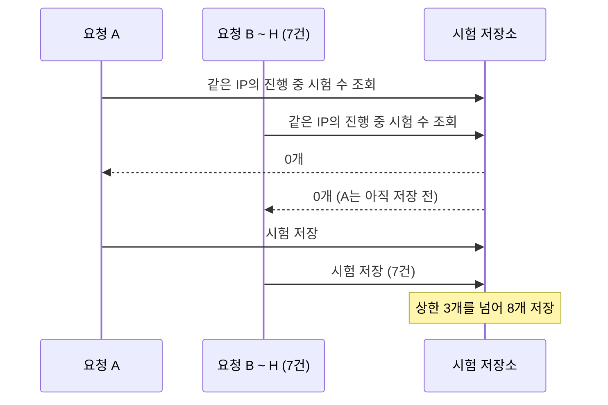
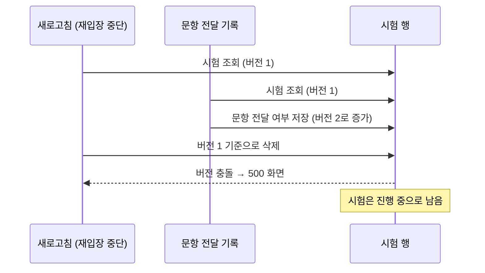
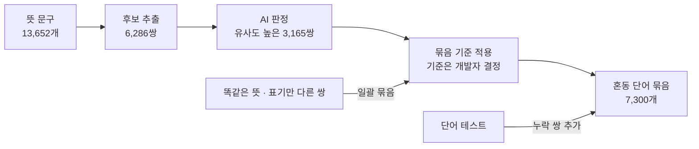

# 문제 해결 사례

VocaRunner를 개발 · 운영하며 발견한 문제와 해결 과정을 정리한 문서입니다. README [문제 해결 사례](../README.md#문제-해결-사례)의 상세판입니다.

## 요약

| 사례 | 문제 | 해결 |
|---|---|---|
| [1. 동일 시험의 동시 제출](#1-동일-시험의-동시-제출-처리) | 같은 시험을 동시에 두 번 제출하면 500 | 저장 충돌을 업무 오류(400)로 응답 |
| [2. 동시 시작 상한 우회](#2-동시-시작-요청의-상한-우회-차단) | 동시 시작 8건이 상한 3개를 모두 통과 | 시작 처리를 잠금으로 하나씩 실행 |
| [3. 흐름 재설계로 경합 제거](#3-흐름-재설계를-통한-경합-결함-제거) | 시작 직후 새로고침 시 드물게 500 | 시험 생성 시점을 옮겨 경합 경로 제거 |
| [4. 공용 IP 환경의 시작 차단](#4-공용-ip-환경의-시작-차단-해소) | 공인 IP를 공유하는 사용자가 거절됨 | 기기 쿠키로 사용자 구분 |
| [5. 혼동 단어 쌍 탐지](#5-혼동-단어-쌍-탐지) | 뜻이 같은 보기가 함께 나와 정답이 둘 | 임베딩 · AI 판정 · 단어 테스트 병행 |
| [6. WAF 본문 크기 제한](#6-waf-본문-크기-제한의-사전-발견) | WAF가 500문항 제출을 차단 | 해당 규칙만 감시 모드로 전환 |
| [7. 뒤로 가기 시 종료된 시험](#7-뒤로-가기-시-종료된-시험의-재표시) | 끝난 시험이 다시 표시됨 | `Cache-Control: no-store` |
| [8. 배포 순서](#8-db-변경을-배포-앞뒤로-나눈-배포-순서) | DB 변경과 옛 · 새 버전의 불일치 | DB 변경을 배포 앞 · 뒤로 나눔 |

## 서비스 구조 요약

사례를 이해하는 데 필요한 구조만 정리합니다. 상세는 README [시험 흐름](../README.md#시험-흐름)과 [용어 사전](glossary.md)을 참고하세요.

- **시험 흐름**
  1. 메인에서 레벨 선택
  2. 준비 화면 — 안내 · 소리 확인
  3. [시작] → 문항(최대 500개)을 한 번에 받아 문항당 5초씩 풀이
  4. 선택한 보기를 한 번에 제출 → 서버 채점
  5. 결과 화면 (결과는 1시간 보관)
- **저장 구조**: 시험 1회 = DB 시험 테이블의 1행
  - 보기 · 정답 · 선택한 보기를 배열로 한 행에 저장 (500문항 기준 약 10KB)
  - 선택한 보기는 제출 전까지 브라우저에만 있고, 제출할 때 한 번에 저장
  - 행마다 버전 칼럼을 두어, 같은 행을 두 요청이 동시에 수정하면 늦게 저장하는 쪽을 실패시킴 (낙관적 잠금, JPA `@Version`)
- **진행 중 시험 제한**: 기기당 1개 · IP당 50개 · 전체 20,000개
  - 전체 상한: 서버 · DB 자원 보호 (20,000개 × 약 10KB ≈ 200MB 이하)
  - 기기 = 브라우저마다 쿠키로 부여하는 무작위 값. 같은 기기에서 새로 시작하면 이전 시험은 중단(삭제)
  - IP 상한: 쿠키를 지워 가며 시험을 만드는 남용 방지용
- **서버 구성**: 사용자 → CloudFront(HTTPS · WAF) → 서버 1대(Spring Boot) → PostgreSQL(같은 서버)
- **표기**: 날짜는 2026년 기준, 오류 코드는 현재 이름(`EXAM_…`)으로 표기

---

## 대표 사례

### 1. 동일 시험의 동시 제출 처리

> 같은 시험을 동시에 두 번 제출하면 늦은 요청이 500 → 저장 충돌을 업무 오류로 응답하고, 응답이 유실된 재제출도 결과 화면으로 연결

**배경**

- 제출은 시험 행 하나를 '진행 중 → 완료'로 바꾸는 수정
- 같은 행을 두 요청이 동시에 수정하면 버전 칼럼 때문에 늦게 저장하는 쪽이 실패

**문제**

- 같은 시험의 제출 요청 2건이 동시에 도착하면 늦은 요청이 500(내부 서버 오류)으로 응답하고 오류 로그 기록
- 채점은 1회만 반영됨
- 브라우저 테스트에서 요청 2건을 의도적으로 동시에 보내 발견 (10/24) — 화면은 제출을 한 번만 보내므로 일반 사용에서는 드묾

**원인**

- 늦은 요청의 저장 충돌 예외를 처리하는 곳이 없어 공통 예외 처리기가 500으로 응답

**해결** (10/28)

1. 저장 충돌을 400 `EXAM_002`(진행 중이 아닌 시험)로 응답 — 이미 제출한 시험을 다시 제출한 경우와 같은 응답
2. 롤백된 늦은 요청도 제출 로그를 남겨 로그가 두 번 기록되던 문제 → 제출 로그를 트랜잭션 커밋 이후에 기록
3. 저장은 됐는데 응답만 유실된 경우(Wi-Fi ↔ LTE 전환 등), [다시 제출]이 거절되어 결과를 볼 수 없던 문제 → 제출이 '진행 중 아님'으로 거절되면 화면이 결과를 조회해 결과 화면으로 이동

> [!IMPORTANT]
> 충돌 자체는 의도한 동작(같은 시험의 두 번째 제출은 거절이 맞음)이므로, 잠금 방식은 유지하고 응답만 업무 오류로 정리

**결과**

- 검증
  - 서비스(실제 PostgreSQL): 두 트랜잭션이 같은 시험을 제출하면 먼저 커밋한 쪽만 남고 늦은 쪽은 저장 충돌
  - 서비스: 제출 로그는 커밋 이후에만 기록되고, 롤백되면 기록되지 않음
  - 웹 계층: 저장 충돌을 400으로 응답
  - 브라우저 테스트: 제출 요청이 서버에 도달한 뒤 연결을 끊어 재현 → [다시 제출] 시 결과 화면으로 이동
- 남은 한계: 같은 제출이 다시 와도 같은 결과를 돌려주는 처리(멱등 처리)는 없음
  - 늦은 제출은 오류를 받고 화면이 결과를 다시 조회해 보완
  - 늦은 요청의 채점 작업은 커밋 시점에 버려짐

---

### 2. 동시 시작 요청의 상한 우회 차단

> 동시 시작 요청 8건이 '진행 중 3개' 제한을 모두 통과 → 시작 처리를 한 번에 하나씩 실행하도록 변경

**배경**

- 발견 당시 시험은 서버 메모리 저장소에 보관
- 시작 전에 같은 IP의 진행 중 시험 수를 세어 3개 이상이면 거절

**문제**

- 같은 브라우저(같은 IP)에서 시작 요청 8건을 동시에 보내면 8건 모두 시작 — 기대 결과는 3건 시작 · 5건 거절
- 브라우저 테스트에서 상한을 동시 요청으로 넘을 수 있는지 의도적으로 검증해 발견

**원인**

- 시작 처리가 '진행 중 시험 수 세기 → 3개 미만이면 저장' 두 단계로 나뉘고, 그 사이에 다른 요청이 끼어들 수 있음
- 8건이 거의 동시에 세면 서로 아직 저장하기 전이라 모두 0개로 보고 통과

**해결** (10/23)

1. 메모리 저장 단계: 시작 처리(세기 → 저장)를 `synchronized`로 감싸 한 번에 하나씩 실행
2. 같은 날 시험을 DB에 저장하도록 바꾸면서(재시작 시 진행 중 시험이 사라지던 문제 해결) DB 잠금으로 교체
   - PostgreSQL advisory lock(`pg_advisory_xact_lock`): 테이블 행이 아니라 정해 둔 번호 하나에 거는 DB 잠금
   - 트랜잭션 범위 잠금이라 커밋까지 유지 → 다음 요청은 앞 요청이 저장한 시험까지 포함해 진행 중 시험 수를 확인
   - DB 저장에서는 트랜잭션만으로는 막히지 않음: 기본 격리 수준(READ COMMITTED)에서는 다른 트랜잭션이 아직 커밋하지 않은 행이 보이지 않고, 개수를 세는 조회는 서로를 기다리지 않음
3. 현재 구조
   - 잠금 번호는 하나 — 모든 시작 요청을 하나씩 순서대로 처리. 전체 상한(20,000)까지 함께 세므로 IP · 기기별로 나눈 잠금으로는 부족
   - 시간이 오래 걸리는 문항 생성(최대 500문항)은 잠금 밖에서 수행하고, 잠금 안에서는 재확인 · 같은 기기의 이전 시험 중단 · 저장만 수행
   - 상한 초과가 확실한 요청은 잠금 전에 걸러 문항 생성 자체를 생략

- 함께 고친 문제: 문항을 받아 가지 못한 시험이 상한을 계속 차지함 → 시작 후 일정 시간(현재 2분) 안에 문항이 전달되지 않은 시험은 정리 대상

**다른 방법과 비교** (DB 저장 기준)

| 방법 | 이 상황에서 |
|---|---|
| 행 잠금 (`SELECT … FOR UPDATE`, 이미 저장된 행을 잠가 다른 요청을 기다리게 함) | 세는 대상이 지금부터 저장될 행이라 잠글 행이 아직 없음 |
| 잠금 전용 행 (별도 테이블의 행 하나를 잠금) | 가능하지만 잠금만을 위한 테이블이 필요 |
| 직렬화 격리 수준 (SERIALIZABLE) | 충돌한 트랜잭션을 다시 실행하는 처리가 필요 |
| Redis 분산 락 | 서버 1대 · DB 1개 구성에서 인프라와 비용만 증가 |
| `synchronized` (애플리케이션 잠금) | 메모리 저장 단계의 해결. 커밋과 묶이지 않음 — 트랜잭션 안에서 잡으면 커밋 전에 풀려, 다음 요청이 저장 전의 진행 중 시험 수를 확인할 수 있음 |

> [!IMPORTANT]
> 아직 저장되지 않은 행은 행 잠금으로 막을 수 없음 → 추가 테이블 · 인프라 없이 커밋까지 유지되는 DB 잠금(advisory lock) 사용

**결과**

- 검증
  - 자동 테스트(실제 PostgreSQL): 시작 잠금을 잡은 동안 다른 트랜잭션은 같은 잠금을 얻지 못함
  - 브라우저 테스트: 같은 기기에서 시작 요청 8건 동시 전송 → 진행 중 시험 1개만 남음 (현재 규칙 기기당 1개)
- 남은 한계
  - '동시 시작 8건' 시나리오 자체는 브라우저 테스트로만 확인
  - 시작 요청이 하나씩 처리되므로 요청이 몰리면 대기 증가
  - 트랜잭션 범위 잠금이므로, 잠금 호출이 트랜잭션 밖으로 옮겨지면 즉시 해제됨 → 구조 변경 시 주의 (현재는 트랜잭션 템플릿 안에서 호출)

---

### 3. 흐름 재설계를 통한 경합 결함 제거

> 시작 직후 새로고침 시 드물게 500 → 예외 처리를 더하는 대신 시험 생성 시점을 옮겨 경합 경로 자체를 제거

**배경** (당시 흐름)

- 메인에서 레벨을 선택하면 바로 시험을 만들고 시험 화면(`/exam/{id}`)으로 이동 — 안내를 읽는 동안에도 시험 시간이 흐름
- 선택한 보기는 제출 전까지 브라우저에만 있어 새로고침하면 사라짐 → 이어 풀 수 없으므로, 시험 화면 새로고침(같은 브라우저의 재입장)은 진행 중 시험을 중단(조회 → 삭제)
- 화면은 페이지를 떠날 때 중단 요청을 보냄
- 서버는 문항을 전달하면 '문항 전달 여부'를 시험 행에 저장 — 문항을 받지 못한 시험을 일정 시간 뒤 정리하기 위한 표시 (사례 2)

**문제**

- 시험 시작 직후 새로고침 시 드물게 500 화면이 표시되고, 시험이 진행 중 상태로 남기도 함
- 아키텍처 전환 작업 중 브라우저 확인에서 1회 발생 (11/03), 조건을 바꿔 55회 다시 시도했으나 재현되지 않음

**원인**

- 같은 시험 행을 수정하는 요청 두 개가 겹침
  - 새로고침 시의 중단(조회 → 삭제)과, 페이지 이탈 중단 요청 또는 문항 전달 기록이 거의 동시에 실행
  - 두 요청이 같은 버전의 행을 읽은 뒤 저장하면 늦은 쪽이 버전 충돌로 실패
- 화면 조작으로는 재현되지 않아, 리팩토링 전에 만든 안전망 테스트(유스케이스별 실제 DB 상태 검증)에서 두 트랜잭션의 실행 순서를 `CountDownLatch`로 강제로 맞춰 세 가지 순서를 재현
  1. 중단 두 건이 겹침 → 늦은 쪽 실패, 시험은 삭제됨
  2. 중단이 행을 읽은 뒤 문항 전달 기록이 먼저 저장 → 중단 실패 = **500 화면 + 시험이 진행 중으로 남음** (아래 그림)
  3. 반대 순서 → 문항 전달 실패

**해결** (11/05)

- 진행 중이던 기획 '시험 시간 측정을 첫 문항부터 시작'에 맞춰 흐름을 재설계 (별도의 예외 처리는 추가하지 않음)
  - 준비 화면(안내 · 소리 확인)을 시험 생성 앞으로 옮기고, [시작]을 누를 때 시험 생성 · 시간 측정 시작
  - 시험 화면 주소와 재입장 중단이 사라져, 500 화면이 생기던 경로 자체가 없어짐
  - 페이지 이탈 중단 요청 하나만 남아 중단끼리도 겹치지 않음

**다른 방법과 비교**

| 방법 | 이 상황에서 |
|---|---|
| 재입장 화면 · 중단 API에서 버전 충돌을 잡아 처리 | 경합이 생기는 경로는 그대로 남고, 경로마다 예외 처리가 늘어남 |
| 흐름 재설계 | 경합 경로 자체가 사라짐, 시간 측정 기획도 함께 해결 |

> [!IMPORTANT]
> 증상(500)을 예외 처리로 덮는 대신, 경합이 생기는 경로 자체를 제거

**결과**

- 검증: 서비스 계층의 경합 동작은 재현 테스트 3건으로 고정, 리팩토링 후 브라우저 회귀 테스트 100회
- 남은 한계: 서비스 계층의 경합 자체는 남아 있음 — 사용자 경로에서 발생하지 않도록 흐름으로 차단한 상태

---

### 4. 공용 IP 환경의 시작 차단 해소

> IP 단위 제한이 공인 IP를 공유하는 사용자를 차단 → 기기 쿠키로 사용자를 구분하고 IP 상한은 남용 방지용으로만 유지

**배경**

- 로그인이 없어 진행 중 시험 수를 제한하려면 '같은 사용자'를 구분할 기준이 필요
- 당시 기준: 연결 IP당 진행 중 시험 3개

**문제**

- 통신사망(CGNAT) · 학교 · 학원 · 회사 Wi-Fi는 여러 사람이 공인 IP 하나를 공유 → 교실에서 동시에 시작하면 4번째부터 거절
- 반대로 로컬에서는 같은 기기가 IPv4 · IPv6로 따로 집계되어 6개까지 진행
- 브라우저 테스트 중 제한 로직이 연결 IP 기준임을 확인하고 실제 사용 환경을 검토해 도출 — 서비스 공개(10/30) 전에 해결

**원인**

- 제한 단위(IP)가 실제 사용자 단위와 다름

**해결** (10/23)

1. 기기 쿠키 기준 기기당 진행 중 1개 — 같은 기기에서 새로 시작하면 이전 시험 중단
2. IP당 50개 상한은 쿠키를 지워 가며 시험을 만드는 남용 방지용으로만 유지
3. 배포 설계 단계에서 추가로 처리
   - CloudFront를 거치면 서버가 보는 연결 IP가 모두 CloudFront 주소 → CloudFront가 붙이는 `CloudFront-Viewer-Address` 헤더에서 사용자 IP 추출 (10/27)
   - 이 헤더는 위조될 수 있으므로 CloudFront를 거친 요청만 받음
     - 서버 포트는 CloudFront에서만 접근 가능하도록 제한
     - 이 제한은 다른 계정의 CloudFront도 통과하므로, CloudFront에 설정한 비밀 헤더가 없거나 틀린 요청은 403으로 거절 (10/30)

**다른 방법과 비교**

| 방법 | 이 상황에서 |
|---|---|
| 로그인 도입 | 개인정보 수집 · 보호 부담, 진입 장벽 증가 |
| 기기 쿠키 | 쿠키를 지우면 새 기기로 인식 → 높은 IP 상한으로 남용만 제한 |

> [!IMPORTANT]
> 로그인 없이 사용자를 구분하는 최소 수단(기기 쿠키)을 쓰고, 쿠키로 막을 수 없는 남용은 높은 IP 상한으로만 제한

**결과**

- 검증
  - 자동 테스트: 헤더 기반 사용자 IP 추출, 비밀 헤더 검사, IP당 상한 거절
  - 브라우저 테스트: 쿠키가 다른 브라우저 5개에서 동시 시작 → 모두 시작 / 같은 기기에서 다시 시작 → 이전 시험 삭제 / 쿠키 없이 51회 시작 → 51번째 거절
- 남은 한계
  - 쿠키 삭제 · 시크릿 창으로 새 기기처럼 시작 가능 (IP당 50개로만 제한)
  - 공인 IP 하나를 공유하는 인원이 50명을 초과하면 51번째부터 거절

---

### 5. 혼동 단어 쌍 탐지

> 뜻이 같은 단어가 한 문항의 보기로 함께 나와 정답이 둘이 됨 → 임베딩으로 후보를 추리고 AI 판정 · 개발자 기준 · 단어 테스트를 병행

**배경**

- 문항 = 영어 단어 1개 + 한국어 뜻 보기 4개(정답 1 + 오답 3)
- '혼동 단어 묶음'에 속한 단어끼리는 한 문항의 보기로 함께 출제하지 않음 → 묶음을 빠짐없이 만드는 것이 관건

**문제**

- 뜻이 같거나 가까운 단어가 보기로 함께 나오면 정답이 두 개처럼 보임 (예: sir "선생님" ↔ teacher "선생님")
- 단어 테스트(회차마다 출제된 문항 전체를 읽는 검사)에서 계속 발견
- 규모: 단어 약 8,600개, 뜻 문구 13,652개 → 발견할 때마다 추가하는 방식으로는 끝나지 않음

**원인**

- 같은 뜻을 다른 단어 · 다른 표기로 쓰는 경우가 많아 문자열 비교만으로는 찾을 수 없음 (예: "반대" ↔ "정반대")

**해결** (10/29 ~ 10/31)

1. 뜻 문구를 임베딩 모델(bge-m3)로 벡터화 — 뜻이 가까울수록 벡터도 가까움
2. 후보 추출 → 6,286쌍
   - 뜻 문구마다 같은 레벨 안에서 가장 가까운 3개 중 유사도 0.85 이상인 쌍
   - 문자열 규칙(어미 · 괄호 차이 등)에 걸린 쌍
3. AI 판정: 유사도가 높은 순으로 단계별 진행, 쌍마다 강함 · 중간 · 약함 · 아님으로 분류하고 이유를 기록
   - 0.9 이상 1,850쌍 → 0.85 ~ 0.9 유의어 1,315쌍 (0.85 미만은 판정하지 않음)
4. 묶음 기준은 개발자가 정하고, 기준에 맞는 쌍을 묶음에 반영
   - 똑같은 뜻: 일괄 묶음
   - 표기만 조금 다른 뜻(어미 · 괄호 · 앞부분 차이): 일괄 묶음, 단 뜻이 다른데 글자만 겹치는 쌍(belly "배" ↔ pear "(과일) 배")은 개발자 확인으로 제외
   - 표기가 다른 유의어: AI 판정의 강함 · 중간만 묶음 (쌍마다 다시 검토하지 않고 판정 결과를 그대로 반영)
   - 상위어 · 하위어 · 정도 차이 · 반대말 같은 약한 관계는 정답이 둘로 보이지 않으므로 제외
5. 단어 테스트로 누락 확인

- 모델 교체
  - 처음 쓴 모델(ko-sroberta)은 한 토큰짜리 단어(술집 · 발행인 · 온실 등)를 서로 같은 벡터로 산출 → 무관한 쌍이 최고 점수를 받아 결과 사용 불가
  - bge-m3로 교체 (같은 문제 없음, 예: 술집 ↔ 발행인 유사도 0.38)
  - ko-sroberta는 단독으로 계산할 때만 같은 벡터가 되고 접두어를 붙이면 구분된다는 조건까지 확인, 근본 원인은 미확정

**다른 방법과 비교**

| 방법 | 이 상황에서 |
|---|---|
| 전수 수작업 비교 | 규모상 불가 |
| 문자열 규칙 (어미 · 괄호 차이) | 표기가 다른 유의어는 탐지 불가 |
| 임베딩 + AI 판정 + 개발자 기준 + 단어 테스트 | 자동 검사로 후보를 좁히고, 누락은 단어 테스트로 보완 |

> [!IMPORTANT]
> - 자동 검사의 누락을 단어 테스트로 먼저 찾아 둔 쌍으로 측정하고(21쌍 중 15쌍 탐지), 누락분을 잡는 단어 테스트를 함께 운영
> - 유의어 쌍은 AI 판정 결과(강함 · 중간)를 쌍마다 다시 검토하지 않고 그대로 반영 — 잘못 묶여도 그 단어의 오답 보기 후보가 조금 줄 뿐이라 손해가 작음

**결과**

- 혼동 단어 묶음 7,300개 (묶음에 든 단어 5,713개, 전체 단어 8,635개 중)
- 측정: 단어 테스트로 먼저 찾아 둔 혼동 단어 쌍 21개를 위 절차로 검사한 결과 15개 탐지, 6개 누락 (한 글자 뜻 "큰", 유사도가 낮게 나온 "깡충 뛰기" 등)
  - 자동 검사만으로는 부족 → **단어 테스트를 계속 함께 운영하는 이유**
- 애플리케이션 최종 방어선: 보기 뜻이 하나라도 같은 단어는 한 문항에 함께 출제하지 않음
- 남은 한계
  - 유사도 0.85 미만인 쌍은 AI 판정을 거치지 않음 (단어 테스트로 보완)
  - 측정 표본(21쌍)이 작음
  - 동음이의어 · 한 글자 뜻은 임베딩으로 잘 걸리지 않음

---

## 기타 사례

### 6. WAF 본문 크기 제한의 사전 발견

> WAF 기본 규칙이 500문항 제출을 차단한다는 점을 배포 전 계산으로 발견 → 해당 규칙만 감시 모드로 전환

**배경**

- CloudFront 무료 요금제는 WAF(웹 방화벽) 사용이 필수이고, AWS 관리형 기본 규칙만 사용 가능 (규칙 최대 5개)
- 시험 제출은 선택한 보기 전체를 한 번에 보내므로 요청 본문이 큼

**문제**

- 기본 규칙 중 '본문 8KB 초과 요청 차단' 규칙이 시험 제출을 차단
- 배포 전 규칙을 검토하며 계산으로 발견 (10/30): 제출 본문은 문항당 약 40바이트 × 500문항 = 약 20KB → 약 200문항부터 차단

**해결**

- 해당 규칙만 감시(Count) 모드 — 차단하지 않고 걸린 횟수만 기록 — 로 전환, 나머지 규칙은 차단 유지

> [!IMPORTANT]
> 제출 주소만 예외로 두는 방법은 규칙 수 한도(5개)를 모두 쓰면서도, 큰 본문은 어차피 제출 주소로만 들어오므로 보호 범위가 사실상 같음 → 단순한 쪽 선택

**결과**

- 배포 직후 약 20KB 제출이 WAF를 통과하는지 확인
- 남은 한계: 애플리케이션 단의 본문 크기 상한은 두지 않음

---

### 7. 뒤로 가기 시 종료된 시험의 재표시

> 결과 화면에서 뒤로 가면 끝난 시험을 다시 풀 수 있음 → 첫 가설(bfcache)을 재현으로 반증하고 HTTP 캐시를 차단

**배경**

- 시험 화면은 문항 전체를 한 번에 받아 브라우저 안에서 진행하고 마지막에 한 번 제출

**문제**

- 결과 화면에서 [뒤로] → 이미 제출한 시험이 처음부터 다시 표시되어 끝까지 풀 수 있었음
- 서버에서는 이미 종료된 시험이지만 화면은 캐시된 문항으로 진행 → 마지막 제출에서야 실패 안내 (휴대폰 뒤로 가기 제스처로 쉽게 발생)

**원인**

1. 첫 가설: 브라우저의 뒤로 가기 캐시(bfcache)가 페이지를 메모리째 복원
2. 의문점: 화면에는 bfcache 복원을 감지하는 처리가 이미 있었는데 동작하지 않음
3. 재현 결과: 페이지는 새로 로드됨(`pageshow`의 `persisted=false`) → bfcache가 아님
4. 실제 원인: 시험 화면 HTML과 문항 API 응답이 모두 **HTTP 캐시**에서 제공됨 — 서버에 요청하지 않아 전송량 0, 같은 시점에 서버에 직접 요청하면 거절

**해결** (10/23)

- 시험 화면과 시험 API 응답에 `Cache-Control: no-store` → 뒤로 가도 서버에 다시 요청해 종료 안내 후 메인으로 이동
- 이후 흐름 재설계(사례 3)로 시험 화면 주소가 사라졌고, 결과 화면에서 뒤로 가면 메인으로 이동하도록 정리 (11/06)

> [!IMPORTANT]
> 첫 가설대로 바로 고치지 않고 재현으로 검증해, 실제 원인(HTTP 캐시)을 찾음

**결과**

- 브라우저 테스트로 시험 화면 · 문항 응답에 `no-store`가 붙고 캐시에서 제공되지 않는 것을 확인

---

### 8. DB 변경을 배포 앞뒤로 나눈 배포 순서

> 리팩토링으로 생긴 DB 변경 3가지를 운영에 반영 → 변경을 배포 앞 · 뒤로 나눠 롤백 가능 구간을 확보

**배경**

- 서버 1대에서 애플리케이션을 교체하는 방식이라, 교체 전후로 옛 애플리케이션과 새 애플리케이션이 같은 DB를 사용
- 애플리케이션은 기동할 때 DB 구조가 코드와 맞는지 검사 (`ddl-auto: validate`)
- DB 구조 변경은 마이그레이션 도구 없이 수동 SQL로 수행

**문제** (11/07 재배포)

- 반영할 DB 변경 3가지
  - 시험 상태 값 `EXPIRED` 삭제 (상태 허용 값 제약 변경)
  - 과목 값(시험 종류를 나타내는 값) `EN_KO` → `ENGLISH` (칼럼 이름 `direction`은 유지)
  - 애플리케이션이 읽지 않던 문항 수 칼럼 삭제
- 한 번에 적용하면 옛 · 새 애플리케이션 중 하나가 DB와 맞지 않음
  - 새 애플리케이션은 `EXPIRED`를 모름 → 해당 행이 남아 있으면 읽을 때 오류
  - 새 애플리케이션은 문항 수 칼럼에 값을 넣지 않음 → NOT NULL 제약 위반
  - 옛 애플리케이션은 삭제된 칼럼을 찾음 → 기동 시 검사 실패 (옛 버전으로 되돌릴 수 없음)

**해결** (11/07)

1. 배포 전 (옛 · 새 애플리케이션 모두와 호환되는 변경): 진행 중 시험 0건 확인, `EXPIRED` 행 확인 · 삭제, 문항 수 칼럼의 NOT NULL 해제
2. 새 애플리케이션으로 교체 → 사이트에서 시험 시작까지 확인 (여기까지는 옛 버전으로 되돌리기 가능)
3. 배포 후: 상태 제약 교체 · 과목 값 변경 · 칼럼 삭제를 한 트랜잭션으로 실행

- 과목 값을 배포 뒤에 바꾸는 이유: 배포 전에 바꾸면 옛 애플리케이션이 `ENGLISH`를 읽지 못함 — 2 ~ 3단계 사이에는 남은 옛 결과를 읽을 수 없지만, 옛 결과 화면 주소가 새 애플리케이션에 없어 영향 없음
- 새 jar를 미리 서버에 올려 두어 1단계와 2단계 사이 간격을 최소화
- 진행 중 시험 0건 조건: 배포 전에 열려 있던 화면은 옛 API 주소를 호출하므로 새 애플리케이션에서 시험을 끝낼 수 없음

> [!IMPORTANT]
> 되돌릴 수 없는 변경(칼럼 삭제)은 새 애플리케이션을 확인한 뒤로 미뤄, 문제가 생기면 옛 버전으로 돌아갈 수 있는 구간을 확보

**결과**

- 운영 반영 후 상태 제약과 칼럼 삭제를 조회로 확인
- 남은 한계: 1회 수동 절차 (마이그레이션 도구 미도입), 서버 1대 재시작 방식이라 무중단 배포가 아님
